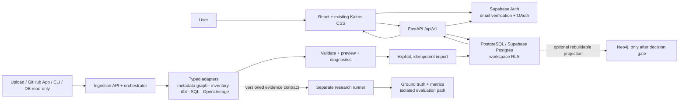

# Kairos Product and Research Architecture

**Status:** working architecture for the current product/demo build
**Reconciles:** local GitHub checkout at `720d89b`, the checked-in research architecture, and the Hatchable v306 ZIP snapshot supplied in the repository.
**Purpose:** define one implementable demo path without conflating product ingestion with the independent lineage research engine.

## 1. Decisions and boundaries

1. **Two related deliverables, two bounded contexts.** Kairos Product handles identity, workspaces, source access, metadata import, catalog/lineage views, and operations. Kairos Research evaluates execution-conditioned lineage reasoning under the contract in `FINAL_ARCHITECTURE_AND_RESEARCH_EXECUTION_PACK.md`. Product connectors may feed versioned evidence into research contracts later; neither context imports the other.
2. **Supabase is the shared product backend platform.** The team uses one shared Supabase project for Auth and its hosted Postgres database (plus Storage if file retention is needed). That hosted Postgres is the authoritative store for catalog, workspace, import, and audit records; a separate local PostgreSQL server is not required for product development/demo. Local PostgreSQL remains optional for offline/research experiments. Neo4j remains optional and derived, only after a measured need and rebuild test.
3. **One workspace per new user for the demo.** The current migration provisions a personal workspace. Every catalog record and import belongs to one workspace, enforced by PostgreSQL RLS. Existing rows remain in the isolated `Legacy catalog`; they are not assigned to the first user.
4. **Source access and Kairos sign-in are separate.** Google/GitHub/Microsoft OAuth into Supabase proves the person’s identity to Kairos. It does not grant access to that person’s private GitHub repositories or databases. A GitHub App/OAuth grant or a user-supplied file/connection is a separate, least-privilege source authorization.
5. **One ingestion pipeline, many typed adapters.** Do not make one parser guess every format. A shared orchestrator runs format-specific adapters, validates their typed output, previews it, then commits it idempotently. Unknown formats are rejected with actionable diagnostics.
6. **Evidence semantics are preserved.** Metadata declarations and parsed SQL are not runtime observations. OpenLineage run events are observations at the granularity they actually contain. Missing runtime events are not proof of non-propagation. Four-state reasoning and the independent ground-truth boundary remain governed by the research architecture.
7. **The demo shows persisted data only as connected data.** Fixture/demo preview is visibly labeled and isolated. A “connected catalog” claim requires a successful authenticated import and a subsequent read from the workspace-scoped API.

## 2. System view



### Runtime components

| Component | Responsibility | Current repository state |
|---|---|---|
| Web app | React/Vite application entry and shell; existing dashboard renderer/CSS retained during migration; auth and import experiences | Vite/React shell exists, dashboard remains bridged to legacy renderer; not a React rewrite |
| Identity | Supabase email/password, verification, OAuth callback/session refresh | Frontend flow and backend token verification exist; provider settings and live end-to-end callback are not verified in this repository |
| API | FastAPI, bearer verification, versioned routes and typed request/response schemas | Existing catalog/search/lineage/governance routes; no persistent import endpoint yet |
| Workspace data | Shared Supabase Postgres, migrations, RLS, transaction boundary | Local `.env` has non-placeholder settings for the supplied project; migration 0003 still must be verified against the shared project before claiming tenant isolation is active there |
| Ingestion | Format routing, parse, normalize, validation, preview, explicit commit, audit | Pure Python static-file adapters now dispatch metadata-graph JSON, dbt manifests, file inventories, and CSV headers into the shared v1 envelope; authenticated preview/commit and durable import remain M3 work |
| Research | Offline reproducible experiments; SQLGlot static candidates, runtime evidence, four-state inference, independent truth | Research packages and tests exist; preserve contract and keep this outside product import claims |
| Optional graph projection | Rebuildable projection only if measured traversal need exists | No production dependency; PostgreSQL remains authoritative |

## 3. Ingestion contract: the shared engine

The orchestration engine is shared; adapters remain format-specific. The first implementation should expose a versioned envelope equivalent to:

```json
{
  "contract_version": "kairos.ingest.v1",
  "source": {"kind": "upload|github|database|cli", "ref": "opaque non-secret identifier"},
  "workspace_id": "server-derived; never trusted from request body",
  "idempotency_key": "client-generated stable key",
  "assets": [],
  "relationships": [],
  "runs": [],
  "evidence": [],
  "diagnostics": [],
  "provenance": {"adapter": "name", "adapter_version": "version", "content_sha256": "digest"}
}
```

The server derives workspace/user identity from the verified Supabase token. An adapter supplies assets, relationship candidates, runs, and evidence with source references and timestamps. The orchestrator validates identifiers, limits, relationships, type-specific requirements, and evidence semantics. Preview is read-only; commit is an explicit second action, one transaction, idempotent for the same workspace/source/content key, and emits an audit/import-run record. Return accepted counts, warnings, rejected items, unsupported constructs, and the import ID. Never accept arbitrary client-supplied workspace IDs or write directly from the browser.

### Input formats and honest semantics

| Input | Initial output | It does not prove |
|---|---|---|
| Kairos metadata graph JSON | Explicit assets/relationships, if schema-valid; provenance retained | That an explicitly declared edge ran |
| File inventory / CSV | File assets or CSV header/schema metadata; CSV column types remain unknown unless supplied separately | File membership is not data-flow lineage; header parsing does not inspect data rows or prove runtime behavior |
| dbt `manifest.json` | Declared model dependencies and metadata; the Python adapter supports models, seeds, snapshots, sources, and exposures | That a model executed in a particular run |
| SQL + schema | SQLGlot static dependency candidates for supported SQL subset | That the query ran or that all SQL constructs are supported |
| OpenLineage event JSON | Job/run/dataset observations and only the column facets present | Cell/column propagation where the event has no such evidence; negative evidence from an absent event |
| GitHub repository | Source transport to selected, authorized files/revisions | Import, private access, or lineage by itself |
| Database connection | Read-only metadata extraction under an explicit connector | Writes, query execution, or lineage beyond collected metadata/evidence |

Do not turn parser failures into empty success. Unsupported input produces a diagnostic and is excluded from commit unless the user explicitly accepts a supported partial import. Preserve source, adapter version, file/revision, content hash, observed/declared classification, and event/run identity.

## 4. Product flow for the first working demo

1. Clone the GitHub branch. The current working checkout already has an ignored `.env` configured for the supplied shared Supabase project; on another teammate's machine, copy `.env.example` and use that project's URL, publishable key, and database pooler URI. Follow [`SUPABASE_SETUP.md`](SUPABASE_SETUP.md). Apply migrations 0001, 0002, and 0003 once to the shared project. No local database install is required for the product demo. Configure at least email/password; social providers require callback URLs and provider credentials in Supabase.
2. Create/sign in to Kairos. Verify email when Supabase requires it. The API validates the Supabase access token. The first authenticated API request provisions/returns the user's personal workspace.
3. In Import Metadata, upload one documented `kairos.ingest.v1` metadata graph JSON fixture. The fixture is labelled as a sample until committed. For a public GitHub demo, select an explicitly supported fixture path/revision; public browse alone is not an import.
4. Show preview counts, source provenance, warnings, and unsupported content. Confirm Import.
5. The API writes assets, explicit relationships, evidence, and import/audit status in one workspace-scoped transaction. Refresh the page and read those rows back through authenticated catalog/lineage APIs. Demonstrate workspace isolation with two users or an RLS query test before presenting multi-tenant isolation as proven.
6. Open Catalog and Lineage; show the origin and semantic label for each edge. A declared/parsed edge must not display as runtime-observed. Never make a missing event look like “no lineage.”

### Demo acceptance gate

- A clean clone installs and starts using documented commands; frontend build succeeds.
- A real Supabase user can sign up/sign in and receives verification according to project Auth settings.
- Unauthorized catalog/import requests fail closed; authenticated API identity comes from Supabase, not user-provided JSON.
- Import preview has no database side effect; confirmation persists once; repeated confirmation with the same idempotency key does not duplicate records.
- Catalog results survive refresh and belong to the signed-in workspace; a second workspace cannot read them.
- Each visible relationship shows its source and evidence classification; diagnostics appear for unsupported input.
- Demo fixtures are visibly distinguishable from a user’s imported catalog.

Until these gates pass, describe the experience as a local prototype/preview rather than a working production connector.
## 5. Boundaries, security, and operational rules

- Supabase publishable/anon key is browser-visible by design; service-role keys, DB pooler passwords, GitHub App private keys, OAuth client secrets, and user access tokens are server-only. Do not commit credentials or ZIP environment files.
- API validates bearer tokens with Supabase Auth; database transactions set a server-derived workspace context and run as a non-owner, non-BYPASSRLS role. Every business table must have enforced workspace RLS. Migration execution role and API role are distinct operational concerns.
- GitHub private access should use a GitHub App installation scoped to selected repositories with metadata/content read only. Bind installation/repository grants to the Kairos workspace, validate state and webhook signatures, encrypt tokens, and never log token material. GitHub sign-in alone is insufficient.
- Database source credentials should be read-only, schema-scoped, secret-managed, tested, and revocable. Do not persist raw credentials in browser storage or logs.
- Import validation should cap request bytes, file count, nesting/row/asset count, and parse time. Treat repository and uploaded data as untrusted input; do not execute SQL from uploads.
- Use the repository's migrations as the schema history. Apply each migration to the shared Supabase project once, after checking the project ref, API DB role grants, and backup/rollback plan. Never run destructive local reset commands against the shared project.
- Keep sample/demo data in a visibly separate mode or namespace. Do not mix sample records with Connected Catalog output.
- Keep the 3D Observatory and the existing CSS/palette as product surfaces; their presence does not change data semantics or constitute an ingestion capability.

## 6. Local checkout, Hatchable snapshot, and repository documentation

The current GitHub checkout is the working source for this plan. The Hatchable v306 ZIP, when present locally under `references/snapshots/`, is a separate ignored snapshot/reference, not a live synced workspace or a file included in a Git clone. Its serverless ingestion/UI patterns and documentation are useful design input; its code, auth configuration, database, and “implemented” labels must not be assumed to match this FastAPI/Supabase branch. Reconcile useful behavior behind the versioned contract instead of copying an entire app or maintaining two authoritative APIs.

`FINAL_ARCHITECTURE_AND_RESEARCH_EXECUTION_PACK.md` remains the research contract. It intentionally excludes authentication, product connectors, and cloud deployment from the research MVP. This product architecture adds a delivery layer around it and does not reopen its locked claims, truth-separation rule, or three research inputs: SQLGlot, dbt manifest, OpenLineage.

## 7. Open decisions after the demo slice

| Decision | Default for this milestone | Reopen when |
|---|---|---|
| Hosted runtime | FastAPI backend + Vite-built frontend; Vercel config is a deployment target, not proof of a deployed service | A deployment owner verifies routing, secrets, migrations, and health in a real environment |
| GitHub access | Public read-only browse can support a visual demo; private access later via GitHub App | Private repo connection/import is required |
| Database source connector | CSV/metadata graph file import first | A credentialed database demo is scheduled and least-privilege connection is ready |
| Optional Neo4j | No | Measured PostgreSQL traversal fails agreed workload targets |
| Workspace sharing/roles | Personal workspace only | Team invitations and role-based collaboration are required |
| Supported formats | Versioned explicit allowlist | Adapter has fixtures, diagnostics, security limits, and persistence tests |

