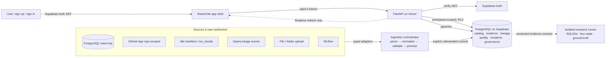

# Kairos — One-Page Final Architecture

**Positioning:** Kairos is an evidence-first data intelligence platform. Like DataHub/OpenMetadata/Atlan it catalogs assets, lineage, quality and governance — but unlike them it shows **why** every lineage edge is trusted, uncertain, refuted, or unknown, using visible evidence, coverage, confidence and time.

**One-line invariant:** *PostgreSQL (hosted on Supabase) is the single source of truth. Every connector feeds one versioned ingestion contract. Every conclusion is derived from stored evidence — never from ground truth, never from a fixture silently substituted for live data.*

---

## 1. System view

## 2. Layers

| Layer | What it is | Runtime |
|---|---|---|
| **Product shell** | Global layout (sidebar / topbar / inspector), Home, Catalog, Asset Detail, Lineage, Sources, Quality, Incidents, Freshness, Evidence, Glossary, Domains, Data Products, Settings | React/Vite (`frontend/`), legacy CSS/renderer bridged during migration |
| **API** | Versioned REST `/api/v1`, typed schemas, capability registry, bearer verification, request-size guard | FastAPI (`backend/app`), serverless entry `backend/api/index.py` on Vercel |
| **Data** | Authoritative store: assets, columns, relationships, raw events, evidence, four-state results, freshness, quality, incidents, contracts, workspaces, audit. `pgvector` for search. | Supabase-hosted PostgreSQL, migrations `backend/migrations/` |
| **Identity** | Sign-up / email verification / OAuth → JWT → server-side workspace membership + role → RLS | Supabase Auth + `0003_personal_workspaces.sql` |
| **Ingestion** | One orchestrator, many typed adapters. Preview is read-only; commit is one idempotent transaction that emits an import-run + audit record. | `ingestion/` adapters + `routes/ingest.py` |
| **Research (separate)** | Offline, reproducible evaluation of execution-conditioned lineage. Never imported by product, never fed ground truth. | `research/`, contract in `FINAL_ARCHITECTURE_AND_RESEARCH_EXECUTION_PACK.md` |
| **Optional projection** | Neo4j / 3D Observatory — rebuildable only, only after a measured need. | Deferred (gate D-06) |

## 3. Connectors → materialization (one contract, many sources)

Every source produces the same versioned envelope `kairos.ingest.v1` (`assets`, `relationships`, `runs`, `evidence`, `diagnostics`, `provenance`). The server derives `workspace_id` from the token — it is never trusted from the body.

| Source | What Kairos reads | What it does **not** prove |
|---|---|---|
| PostgreSQL (read-only role) | catalogs, schemas, tables, columns, constraints | data content, runtime usage, lineage |
| GitHub App (repo-scoped, read-only) | selected files/revisions at a commit | that SQL/dbt ran |
| dbt `manifest.json` / `run_results.json` | models, sources, exposures, tests, declared deps | that a model executed |
| OpenLineage events | job/run/dataset observations + only the facets present | column propagation where no facet exists |
| SQL + schema (SQLGlot) | static dependency candidates for the supported subset | that the query ran |
| File / folder upload | declared metadata, inventory, CSV headers | data authenticity or live connectivity |
| MLflow | models, runs, metrics, features | that a feature contributed at inference |

A user granting a source grants **Kairos the backend** narrowly-scoped read access; Kairos then applies **its own** workspace RBAC/RLS to decide what that user may see.

## 4. Evidence model (the differentiator)

`OBSERVED` (runtime-supported) · `POSSIBLE` (static/declared) · `REFUTED_FOR_RUN` (requires run ID + non-empty coverage + complete-negative marker) · `UNKNOWN` (absent/incomplete). **Missing evidence is never rendered as a negative edge.** Every edge shows source, evidence ID, coverage, confidence, valid time and recorded time.

## 5. Deployment & security

Vercel (frontend build + `backend/api/index.py` function, `/api/*` + `/healthz` rewrites) → Supabase (Auth + Postgres + Storage + Realtime). Server-only secrets: `DATABASE_URL`, `GITHUB_APP_*`, `KAIROS_TOKEN_ENCRYPTION_KEY`. Browser-safe: `VITE_SUPABASE_URL`, publishable key. Service-role keys never leave the server. Every business table carries forced workspace RLS.

## 6. Definition of a working demo (must all pass)

1. A real Supabase user signs up, verifies, signs in; unauthorized requests fail closed.
2. The user connects ≥1 real source (Postgres / GitHub / upload) and sees **preview → explicit commit (idempotent) → read back after refresh**, scoped to their workspace.
3. Every relationship on screen shows its evidence state; no fixture is ever silently substituted for a failed live call; demo data is visibly labelled.
4. A second workspace cannot read the first workspace's rows.
5. Freshness, quality, incidents and search all trace to persisted rows — no fabricated numbers.
